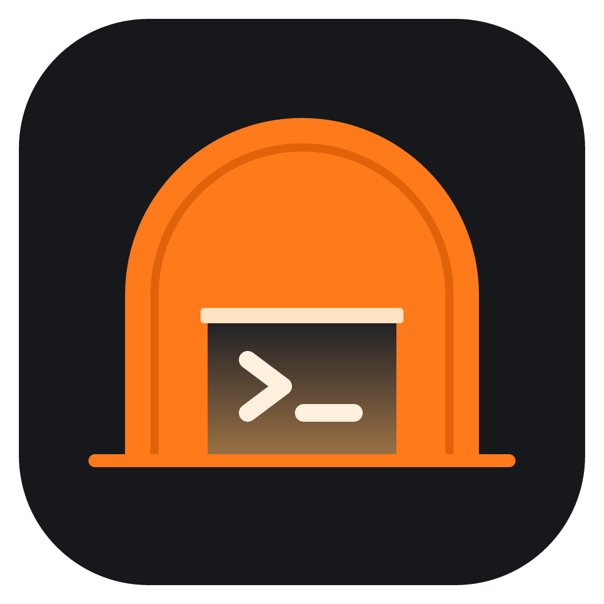

<div align="center">



# Dev Hangar

**Ангар для всех твоих dev-проектов.**
Открыл, увидел стек, нажал Dev — полетели. 🚀

[](https://tauri.app)
[](https://vuejs.org)
[](https://www.rust-lang.org)
[](https://www.typescriptlang.org)
[](#-требования)
[](https://github.com/thebralin/dev-hangar/releases)

[Возможности](#-возможности) · [Установка](#-установка) · [Сборка из исходников](#%EF%B8%8F-сборка-из-исходников) · [Структура](#-структура)

</div>

---

## ✨ Что это

Десктоп-приложение на **Tauri 2 + Vue 3**, которое собирает все твои проекты в одном окне: определяет стек, запускает dev-серверы одной кнопкой, показывает git, файлы, аналитику, граф импортов — и помогает быстро вспомнить, *на чём ты остановился*.

Кинь в окно папку с проектами — Hangar сам найдёт всё вложенное.

## 🧰 Возможности

| | |
|---|---|
| 📂 **Проекты** | Drag & drop папки, кнопка «+» или «Найти проекты в папке…» — вложенные проекты находятся сами (до 2 уровней). Боковую панель можно свернуть в узкую полосу с аватарками (`Ctrl+B`). |
| 🖼️ **Сетка проектов** | Все проекты карточками: обложка, имя, версия, стек, дата последнего обновления. Обложка — своя картинка или автоскриншот: Hangar сам запускает dev, снимает страницу headless-браузером (Edge / Chrome) и останавливает сервер. Можно сразу для всех проектов без картинки. |
| 🧠 **Определение стека** | Vue, Nuxt, Astro, React, Next, Svelte, Express, Hono, Fastify, Elysia, Nest, Electron, Tauri, Node, Bun, Deno, HTML/JS, Rust, Go, Python/Django, PHP, .NET, Java/Gradle, Flutter, CMake, Docker. Монорепы разбираются по модулям. |
| ▶️ **Запуск в один клик** | **Dev** и **Build**, менеджер пакетов (npm / bun / pnpm / yarn) определяется по lock-файлу. В монорепе Dev поднимает все серверы сразу. Цветная консоль, автопоиск URL, остановка убивает всё дерево процессов. В консоли можно печатать: ответить запущенному процессу (stdin) или выполнить любую команду в папке проекта, с историей по `↑`. |
| 🐘 **PHP** | Laravel, Symfony, Yii, CodeIgniter, CakePHP, Slim, Laminas, Drupal, WordPress + Livewire, Inertia, Filament, Doctrine. Миграции, очереди, кэш, тесты (artisan / Pest / PHPUnit), линтеры (PHPStan, Pint, PHP-CS-Fixer, Psalm, Rector). |
| 🌿 **Git** | Полноценный клиент: stage/unstage, commit/amend, fetch/pull/push, ветки, merge/rebase, разрешение конфликтов, stash, теги, cherry-pick, revert, reset, история файлов и diff. |
| 💾 **Чекпоинты** | Снимок всех файлов (включая незакоммиченные) перед правками ИИ. Посмотреть diff и откатиться — одной кнопкой. Хранятся как скрытые refs `refs/devhangar/checkpoints/*`, не трогают ветки и stash. |
| 🪪 **Паспорт проекта** | Описание, статус, задачи, роадмап и документация — markdown-файлами в `.hangar/` внутри репозитория. Вкладка «Паспорт»: доска задач с перетаскиванием, роадмап, документы; статус и прогресс — на карточках сетки. ИИ-агенты читают и обновляют те же файлы. Свой формат можно подключить плагином. [Формат →](docs/PASSPORT.md) |
| ⚡ **Claude Code** | Встроенный плагин: открыть Claude в терминале проекта, отдать ему задачу из паспорта (интерактивно или без вопросов в консоли Hangar), заполнить паспорт по коду. |
| 🤖 **Контекст для ИИ** | Стек, команды, дерево файлов, зависимости, env-переменные, git и заметки → в markdown. Скопировать в чат или сохранить как `CLAUDE.md` / `AGENTS.md`. |
| 📍 **«Где я остановился»** | Последние коммиты, незакоммиченные и недавно изменённые файлы, TODO/FIXME, сколько дней проект не открывали. |
| 📊 **Аналитика** | Тепловая карта коммитов, активность по неделям/месяцам/часам, серии дней, строки кода по языкам, большие и «горячие» файлы, авторы. |
| 🕸️ **Граф связей** | Файлы — узлы, импорты — рёбра. Режимы «слои» и «граф» (как в Obsidian). JS/TS/Vue/Svelte/Astro, CSS, HTML, Python, Rust, Go, PHP (PSR-4, Blade, Twig). В Tauri связывает `invoke("cmd")` с Rust-командой. Циклы, поиск, локальный граф. |
| 🗂️ **Файлы** | Дерево, нечёткий и полнотекстовый поиск, подсветка (Shiki), превью Markdown и картинок, «Открыть в IDE» с переходом к строке. |
| 🧹 **Уборка диска** | `node_modules`, `target`, `vendor`, `dist`, `.next` по всем проектам с размерами — выбери неактивные 30+/60+ дней и удали. |
| 📦 **Зависимости** | npm, Cargo, pip, go.mod, composer — со ссылками на страницы пакетов. |
| 🧩 **Плагины** | Поддержка новых стеков (бейдж, кнопки Dev/Build, зависимости), свои вкладки и экраны с любым интерфейсом, кнопки и реакции на события — на обычном JavaScript. «Создать плагин» — и шаблон уже открыт в редакторе. [Как написать плагин →](docs/plugins/README.md) |

## 📥 Установка

Скачай установщик (`.exe` или `.msi`) со страницы **[Releases](https://github.com/thebralin/dev-hangar/releases)** и запусти.

## 🛠️ Сборка из исходников

### Требования

- **Node.js** 20+ (или Bun)
- **Rust** — <https://rustup.rs> (toolchain `stable-x86_64-pc-windows-msvc`)
- **Microsoft C++ Build Tools** — «Desktop development with C++» в Visual Studio Installer
- **WebView2** — уже есть в Windows 10/11
- **git** в PATH

Подробнее: [tauri.app/start/prerequisites](https://tauri.app/start/prerequisites/)

### Команды

```bash
git clone https://github.com/thebralin/dev-hangar.git
cd dev-hangar
npm install

npm run tauri dev      # режим разработки
npm run tauri build    # сборка установщика
```

Результат сборки:

| Файл | Что это |
|---|---|
| `src-tauri/target/release/dev-hangar.exe` | сам exe |
| `src-tauri/target/release/bundle/nsis/*.exe` | установщик NSIS |
| `src-tauri/target/release/bundle/msi/*.msi` | MSI |

> ⏱️ Первая сборка Rust занимает 3–6 минут, дальше быстрее.

## ⚙️ Настройки

Проекты, заметки и свои команды хранятся в:

```
%APPDATA%\com.bolat.devhangar\config.json
```

Путь также виден в окне «Настройки».

## 🧱 Структура

```
src/                     Vue-фронтенд
├─ components/           вкладки: Overview, Files, Git, Graph, Analytics, Deps, Console…
├─ lib/
│  ├─ store.ts           состояние, запуск процессов, конфиг
│  └─ highlight.ts       подсветка синтаксиса (Shiki)
└─ plugins/
   ├─ host.ts            загрузка плагинов и Plugin API
   └─ hangar.d.ts        типы Plugin API (единый источник правды)

src-tauri/src/           Rust-бэкенд
├─ detect.rs             определение стека, команды запуска, зависимости
├─ php.rs                PHP: composer, фреймворки, команды
├─ git.rs / gitops.rs    чтение и изменяющие git-операции
├─ files.rs              дерево, поиск, чтение файлов
├─ process.rs            запуск/остановка команд, стриминг вывода
├─ checkpoints.rs        чекпоинты (git-refs, временный индекс)
├─ extra.rs              TODO-скан, дерево для ИИ, уборка диска
├─ analytics.rs          аналитика по git-истории и коду
├─ graph.rs              граф импортов
├─ plugins.rs            папка плагинов: список, установка, шаблон
└─ lib.rs                tauri-команды, IDE/терминал, конфиг

docs/plugins/            руководство и справочник API для авторов плагинов
examples/plugins/        примеры: hello-world, hugo-stack, projects-dashboard, npm-outdated, release-checklist
```

**Хочешь добавить что-то своё?** Напиши плагин — [docs/plugins](docs/plugins/README.md).
**Хочешь научить Hangar новому стеку?** Смотри `analyze_module` в [`src-tauri/src/detect.rs`](src-tauri/src/detect.rs).

---

<div align="center">

Сделано с ☕ и Rust · [@thebralin](https://github.com/thebralin)

</div>
